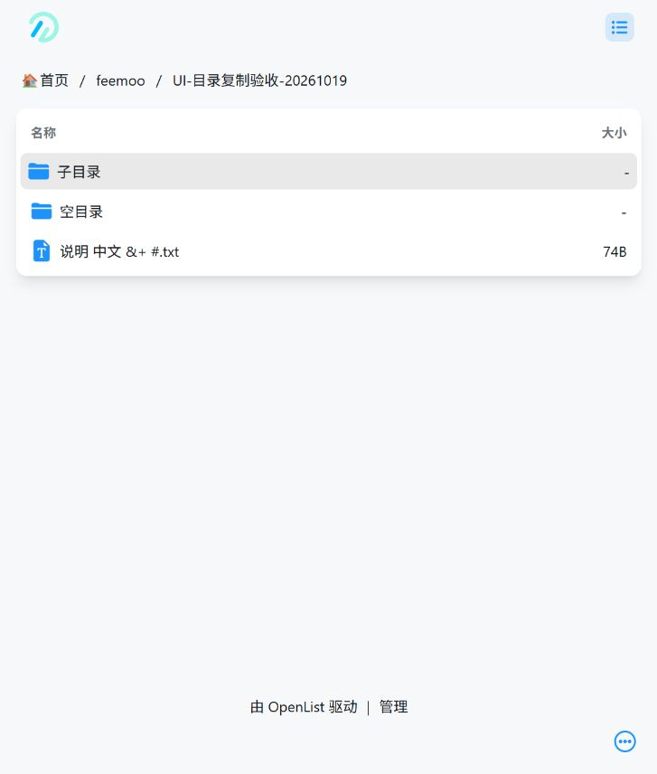

# 飞猫盘 Feemoo 上传驱动（私人定制）

面向 OpenList 跨存储复制，复用原生文件流、复制任务、取消和目录递归。开发分支 `feat/feemoo`，基于本仓库 `main` 的 `3b28270a4066ea52943a69ecddd850d83f7e8bdc`。没有向 OpenList 官方提交 PR。

**已验证真实上传，但尚不能将你自己的阿里云盘 / 115 等实际挂载的最终验收标记完成。** 详细记录见 [验证报告](VALIDATION.md)。

## Windows 安装（不需要 Go）

1. 打开本仓库 GitHub → **Actions** → **Private Feemoo build**，选择分支 `feat/feemoo` 的成功运行。在页面底部 **Artifacts** 下载 `openlist-feemoo-windows-amd64` 并解压。也可使用本次交付的本地 ZIP。
2. 关闭正在运行的旧 OpenList：回到它的命令窗口按 `Ctrl+C`。使用服务运行的，先停止对应服务。
3. 备份原来的整个 OpenList 目录，尤其是 **data** 文件夹和旧的 `openlist.exe`。
4. 将新包中的 **openlist.exe** 复制到原程序目录并替换旧程序。保留你原来的 data 文件夹、启动参数和工作目录。
5. 按原方式启动。在同一目录直接运行时，可以双击包内的“启动OpenList.cmd”。打开原来的 OpenList 地址（通常是 http://127.0.0.1:5244）。
6. 登录管理后台，进入 **存储 → 添加**，驱动列表中选择 **Feemoo**。

首次安装可将 ZIP 解压到新目录，双击启动脚本，按网页初始化向导设置管理员。升级现有安装时不要把原来的 data 放到其他目录；OpenList 数据路径默认与启动工作目录有关。

## 获取你自己的会话并挂载

1. 在 Chrome / Edge 登录 https://www.feemoo.com/ ，确认可以手动上传。
2. 打开安装包的“会话信息提取.html”（源码为 [session-helper.html](session-helper.html)）。按页面提示，在官网按 F12 → Network / 网络 → 点击“文件”，右键 `/disk-service/file/list` 请求 → Copy as cURL (bash)。
3. 仅粘贴到本地提取页，不要发送给任何人。将提取出的四项填入存储配置：`cookie`、`par`、`pto`、`user_agent`。
4. 挂载路径填 **/feemoo**；根文件夹 ID 填 **0**（账号根目录）。临时目录留空即可；可用磁盘空间需要至少为待上传文件大小加 64 MiB。
5. 保存。返回文件页面打开 `/feemoo`，应能看到官网相同的目录。

四项必须来自同一次合法网页登录会话。没有实现密码登录、自动刷新会话或验证码处理。会话失效（10020 / 1012）时，在官网重新登录并更新四项；设备错误 40100 也应重新获取。不要反复重试无效凭据。请求头只发给飞猫盘账号 API，不会发给分片或对象存储地址。

## 从其他网盘复制到飞猫盘

1. 在 OpenList 打开已挂载的来源网盘，先选一个小文件。
2. 点击文件右侧菜单中的 **复制**，或勾选多个文件后在批量操作栏选择 **复制**。
3. 在目标目录选择框中打开 **feemoo**，选择目标目录并确认。
4. 查看 **任务 → 复制** 的进度与错误。飞猫盘要求上传前预计算哈希：前 40% 是准备来源数据，40%～95% 是发送分片；只有合并后重新列目录确认文件名和大小，才报告 100%。
5. 小文件成功后，选择整个来源文件夹执行同样操作。子目录和空目录都保留；无需手动逐个创建目录。
6. 在 https://www.feemoo.com/ 的 **文件** 页面进入目标目录，核对层级、文件数和大小。重要数据建议抽样下载回读校验。

本次在独立 OpenList 实例中，通过上述网页操作从已挂载的 WebDAV 测试来源复制整个文件夹，目标结果如下（均为合成测试文件）：



复制是“来源网盘 → OpenList 服务器 → 飞猫盘”。需要预计算分片哈希时，非可寻址流先缓存到服务器临时磁盘，再按分片读取发送；不将整个大文件读入内存。普通中转上传不称为秒传。只有飞猫盘初始化接口实际返回已存在的文件 ID 时，才跳过内容发送，且仍刷新目录核验。

## 限制和故障处理

- 当前账号实测返回单文件最大 **10 GiB**、分片 **10 MiB**。驱动每次挂载读取账号真实设置；其他账号、会员等级或平台更新可能不同。实测上传了 21 MiB 三分片文件，未测试接近 10 GiB 的文件。
- 支持空文件、中文、空格、`& + #`，已做真实验证。文件夹名按网页限制最多 50 个 UTF-16 字符；超长会报错，不截断名称。
- **暂不覆盖、改名、移动、删除或下载播放。** 同名目标安全报错；勾选 OpenList 覆盖也不会强行删除原文件。已有空文件的覆盖同样不支持。需要覆盖时请在官网自行处理原文件后重试。
- 为避免同一驱动实例中并发重名，写操作按顺序执行。没有实现跨客户端的原子重名锁；传输期间请避免用其他客户端改动相同目标名称。
- 每个分片默认最多额外重试 2 次（可设 0～5）。重试只重发失败分片。支持同一运行任务中的网络故障恢复，**不支持进程重启后的上传会话恢复 / 持久断点续传**。
- 单次分片默认超时 180 秒，可设 1～3600 秒；任务取消会中止网络请求，并用最多 10 秒调用平台取消接口。临时文件在正常成功、失败和取消后删除；强杀进程或断电可能遗留 `feemoo-*` 临时文件，应在确认没有运行任务后手动清理。
- 临时空间不足会在上传初始化前报错；磁盘空间可能被其他程序占用，写入错误也会终止并清理。准备文件期间发生源文件大小不符会直接失败。
- 合并响应丢失时先重新列目录核验，不盲目重复创建会话。列表暂未返回内容哈希，驱动成功判定是远端名称、类型和字节大小匹配；本次开发另做了真实回读 MD5 校验。
- 若平台返回验证码、风控、实名 / 手机绑定、会员或配额要求，请在官网正常处理。驱动不会绕过限制，也不会代为购买会员。

## Docker 自定义镜像

这部分适用于之后迁移到 Docker；Windows 直接运行无需安装 Docker。

```sh
git clone --branch feat/feemoo https://github.com/bqbfanglian/OpenList.git
cd OpenList
docker build -f Dockerfile.feemoo -t openlist-feemoo:local .
docker run -d --name openlist-feemoo --restart unless-stopped \
  -p 5244:5244 -v /你的数据目录:/opt/openlist/data openlist-feemoo:local
```

镜像以 UID/GID **1001:1001** 运行，宿主机数据目录须允许该用户写入。迁移已有数据时先停止原实例、备份 data，再将同一数据目录挂载到新容器；不要让两个实例同时写同一个数据库。

ARM64 构建：`docker buildx build --platform linux/arm64 -f Dockerfile.feemoo -t openlist-feemoo:local --load .`。Dockerfile 使用 CGO 关闭的静态 Go 程序、官方 v4.2.7 前端及固定 SHA-256 校验。不会自动发布镜像。GitHub Actions 中包含 Docker 构建和 `version` 冒烟检查；结果以实际运行记录为准。

## 开发与复测

```sh
go test ./drivers/feemoo ./internal/fs ./internal/stream
go vet ./drivers/feemoo ./internal/fs
bash tools/build-feemoo.sh windows amd64
```

真实复制测试仅在明确设置 `FEEMOO_LIVE_SESSION_FILE` 时运行，文件为本地会话 JSON（`cookie` / `par` / `pto` / `user-agent`）。例如把文件放在仓库外的私有目录，设置该环境变量后执行：

```sh
go test ./drivers/feemoo -run '^TestLiveNativeCopyToFeemoo$' -v -count=1
```

此测试会创建新的 `OpenList_Go_test_*` 目录并上传约 21 MiB 的合成测试数据，不接触已有文件。普通测试和 CI 不需要、也不应配置真实账号凭据。

## API 来源

- 官网公开前端：`https://webimg.app-static.com/Public/web/static/www.feemoo_com.html/static/js/app.a295407d.js`，2026-10-19 获取，SHA-256 `62b41d63a0253fa76d52403906611fe8478d3fbdb8ba712994b1f8f3dabd9076`。
- 认证入口 `fmpapi.feemoo.com`、请求信封模块 17111 / 61981、目录与上传初始化模块 27223、分片发送 / 合并 / 取消模块 71404、哈希模块 58431。
- `protocol_keys.go` 是公开网页随客户端分发的协议编码常量，不是用户账号的私钥、Cookie 或 Token。代码未复制参考项目的签到、广告或设备伪造逻辑。
- 用户提供的参考项目：[LinYuanovo/feemoo](https://github.com/LinYuanovo/feemoo)。该项目为签到任务参考，未找到可直接复用的文件上传实现。

目前使用的是官网网页实际接口，未发现稳定公开的上传开发者文档。未来网页协议变化时可能需要维护更新；所有接口已通过合法账号验证，没有假设存在未见过的刷新或续传接口。
